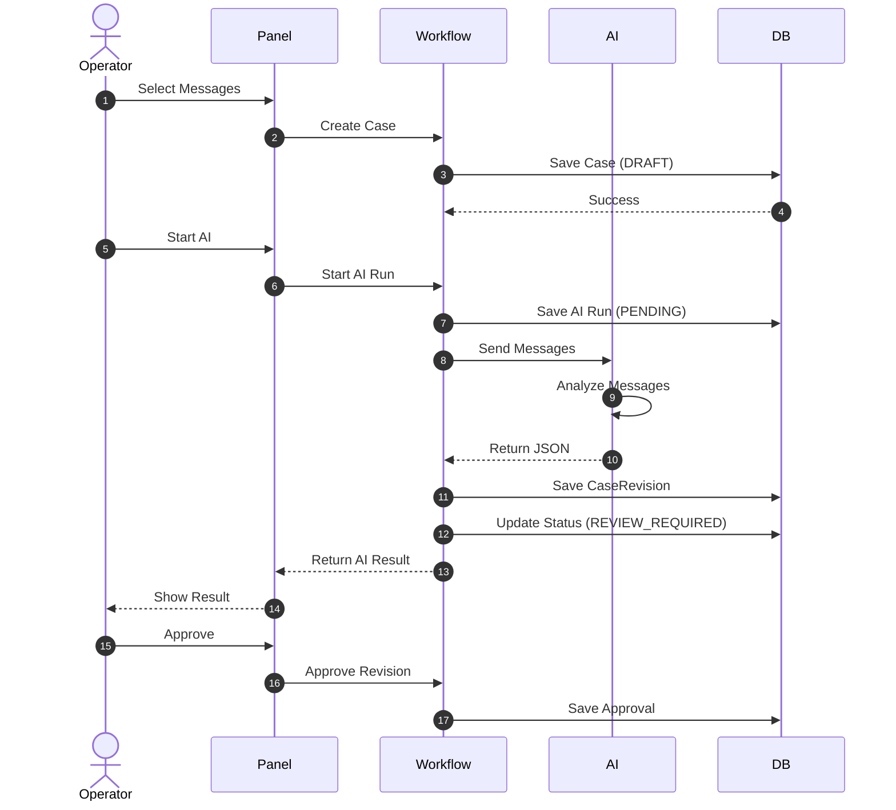

# Backend

این سند در واقع معماری گردش کار (Workflow) دریافت پیام واتساپ، تبدیل پیام‌ها به پرونده مالی و استخراج اطلاعات مالی با AI را توضیح می‌دهد.

ایده اصلی این است که هیچ پیامی به‌صورت خودکار وارد سیستم مالی نمی‌شود. اپراتور ابتدا پیام‌های مرتبط را انتخاب می‌کند، سیستم یک پرونده می‌سازد، AI اطلاعات مالی را استخراج می‌کند و در نهایت اپراتور خروجی را بررسی و تأیید می‌کند.

بیاییم مرحله‌به‌مرحله با دید معماری NestJS بررسی کنیم.

# ۱. تصویر کلی معماری

[Real-Time Engagement Platform with Agentic RAG & Multi-Agent Framework](https://images.openai.com/static-rsc-4/tCXCrsydIEm7qW_aEs0fctVzGtn2tmrRHhgZtBuP9_3DvrjysGiPWfw8Q2fJkyBg8zlqra-WfICyXS1FRX0R8u1aUIUaQxh0gZSSu87mJfuXii8fLrx7NmUZrgTY18k74NKEFJA_QSgd_DetA6BMps1KnZIFZRibDS1p1-ofaoU?purpose=inline)

[xenonstack.com](https://www.xenonstack.com/use-cases/engagement-platform-agentic-rag-multi-agent?utm_source=chatgpt.com)

ما با ۷ سرویس اصلی سروکار داریم:

| سرویس              | وظیفه                           |
| ------------------ | ------------------------------- |
| whatsapp-service   | دریافت پیام از واتساپ           |
| message-service    | ذخیره و آرشیو پیام‌ها           |
| customer-service   | تشخیص مشتری مرتبط               |
| identity-service   | کنترل دسترسی کاربران            |
| workflow-service   | مدیریت پرونده مالی              |
| ai-service         | استخراج اطلاعات مالی از پیام‌ها |
| accounting-service | ثبت سند حسابداری در آینده       |

نکته مهم: `workflow-service` مرکز اصلی این معماری است؛ چون مسئولیت مدیریت چرخه عمر پرونده مالی را بر عهده دارد.

# ۲. مراحل اجرای سیستم

## مرحله اول: دریافت پیام از واتساپ

فرض کن مشتری در یک گروه واتساپ سه پیام می‌فرستد:

```
پیام اول: ۵۰۰۰ دلار حواله کنم
پیام دوم: مقصد دبی
پیام سوم: نرخ ۴۲ درهم
```

سرویس `whatsapp-service` با استفاده از Baileys پیام‌ها را دریافت می‌کند.

در این مرحله دو جدول داریم:

- `InboundEvent`: رویداد دریافتی از واتساپ.
- `OutboxEvent`: رویدادی که باید برای سرویس بعدی ارسال شود.

چرا Outbox؟

فرض کن پیام از واتساپ دریافت شده، اما RabbitMQ قطع است.

اگر پیام فقط در حافظه باشد، ممکن است از دست برود.

بنابراین ابتدا رویداد در دیتابیس ذخیره می‌شود و سپس Worker آن را به RabbitMQ ارسال می‌کند.

این الگو را Transactional Outbox Pattern می‌گویند.

## مرحله دوم: آرشیو پیام‌ها

`message-service` پیام را از RabbitMQ دریافت می‌کند.

سه جدول اصلی دارد:

| جدول           | کاربرد                           |
| -------------- | -------------------------------- |
| InboxEvent     | جلوگیری از پردازش مجدد یک رویداد |
| Message        | اطلاعات اصلی پیام                |
| MessageVersion | نسخه‌های مختلف پیام              |

مثلاً:

```
Message
-------
id: 1201
groupId: 15
senderId: 101
```

```
MessageVersion
--------------
id: 1401
messageId: 1201
content: 5000 دلار حواله کنم
version: 1
```

چرا MessageVersion مهم است؟

فرض کن کاربر پیامش را ویرایش کند.

نسخه اول:

```
۵۰۰۰ دلار حواله کنم
```

نسخه دوم:

```
۶۰۰۰ دلار حواله کنم
```

سیستم باید هر دو نسخه را بشناسد تا مشخص باشد پرونده مالی بر اساس کدام محتوا ساخته شده است.

## مرحله سوم: نمایش پیام‌ها در پنل

React از API پیام‌های گروه را دریافت می‌کند.

```
GET /api/v1/groups/15/messages
```

اپراتور پیام‌ها را می‌بیند.

نکته مهم این مرحله:

صرف مشاهده پیام نباید باعث ایجاد پرونده مالی شود.

یعنی سیستم فقط پیام‌ها را نمایش می‌دهد و هنوز هیچ اتفاق مالی یا Workflow ایجاد نشده است.

## مرحله چهارم: انتخاب پیام‌ها و ایجاد پرونده

اپراتور سه پیام را انتخاب می‌کند و روی «ایجاد درخواست مالی» کلیک می‌کند.

درخواست:

```
POST /api/v1/cases
```

```
{
  "groupId": "15",
  "customerId": "101",
  "caseType": "SETTLEMENT",
  "messages": [
    {
      "messageId": "1201",
      "messageVersionId": "1401"
    },
    {
      "messageId": "1202",
      "messageVersionId": "1402"
    },
    {
      "messageId": "1205",
      "messageVersionId": "1405"
    }
  ]
}
```

در این مرحله سه جدول درگیر هستند:

Case

اطلاعات اصلی پرونده مالی

```
id: 501
customerId: 101
groupId: 15
caseType: SETTLEMENT
status: DRAFT
```

CaseMessage

ارتباط پرونده با پیام‌های انتخاب‌شده

```
caseId: 501
messageId: 1201
messageVersionId: 1401
```

CaseStatusHistory

تاریخچه تغییر وضعیت پرونده

```
caseId: 501
fromStatus: null
toStatus: DRAFT
```

چرا CaseMessage جداست؟

چون هر پرونده می‌تواند چند پیام داشته باشد و یک پیام نیز ممکن است طبق سیاست کسب‌وکار در پرونده‌های مختلف استفاده شود.

در نتیجه رابطه بین Case و Message یک رابطه چندبه‌چند است.

نکته معماری: ساخت Case و تمام CaseMessageها باید در یک تراکنش MySQL باشد. یعنی یا همه ثبت شوند یا هیچ‌کدام.

## مرحله پنجم: ارسال پرونده به AI

حالا پرونده ساخته شده، اما هنوز AI آن را پردازش نکرده است.

اپراتور درخواست پردازش AI را ارسال می‌کند:

```
POST /api/v1/cases/501/ai-runs
```

در این مرحله دو جدول داریم:

- `CaseAiRun`
- `OutboxEvent`

مثلاً:

```
CaseAiRun
---------
id: 9001
caseId: 501
status: PENDING
requestId: abc-123
```

و یک رویداد در Outbox:

```
eventType: CASE_AI_REQUESTED
aggregateId: 501
payload: {...}
```

چرا CaseAiRun لازم است؟

چون ممکن است یک پرونده چند بار به AI ارسال شود.

مثلاً:

- بار اول خروجی ناقص بوده.
- بار دوم اپراتور پیام جدیدی به پرونده اضافه کرده.
- بار سوم از مدل AI دیگری استفاده شده است.

بنابراین باید هر بار اجرای AI به‌صورت مستقل قابل پیگیری باشد.

در اینجا Worker رویداد را از Outbox می‌خواند و به RabbitMQ می‌فرستد.

## مرحله ششم: پردازش اطلاعات توسط AI

`ai-service` پیام‌های انتخاب‌شده را پردازش می‌کند.

ورودی مفهومی:

```
{
  "requestId": "abc-123",
  "messages": [
    "۵۰۰۰ دلار حواله کنم",
    "مقصد دبی",
    "نرخ ۴۲ درهم"
  ]
}
```

خروجی:

```
{
  "operationType": "TRANSFER",
  "amount": "5000",
  "currency": "USD",
  "destination": "Dubai",
  "quotedRate": "42",
  "quotedRateCurrency": "AED",
  "needsReview": true
}
```

اینجا یک نکته بسیار مهم وجود دارد:

AI نباید اطلاعاتی را که در پیام‌ها وجود ندارند حدس بزند.

مثلاً اگر مشتری نگفته باشد نرخ قطعی است یا نرخ پیشنهادی، AI نباید خودش تصمیم بگیرد.

بهتر است خروجی شامل فیلدهای زیر نیز باشد:

```
{
  "confidence": 0.92,
  "missingFields": [],
  "ambiguousFields": [],
  "sourceMessageIds": ["1201", "1202", "1205"]
}
```

این اطلاعات به اپراتور کمک می‌کند بفهمد هر داده از کجا آمده و کدام بخش نیازمند بررسی است.

## مرحله هفتم: دریافت نتیجه AI و ایجاد نسخه مالی

وقتی AI پاسخ را برمی‌گرداند، `workflow-service` نتیجه را دریافت می‌کند.

در این مرحله دو جدول مهم هستند:

CaseAiRun

وضعیت اجرای AI تکمیل می‌شود:

```
id: 9001
caseId: 501
status: COMPLETED
```

CaseRevision

خروجی AI به‌عنوان یک نسخه مالی ذخیره می‌شود.

مثلاً:

```
id: 7001
caseId: 501
revisionNumber: 1
createdBy: AI
```

چرا CaseRevision؟

چون اطلاعات مالی نباید مستقیماً روی پرونده بازنویسی شوند.

فرض کن AI نسخه اول را تولید کرده:

```
amount = 5000
currency = USD
```

اپراتور متوجه می‌شود مبلغ اشتباه است و آن را اصلاح می‌کند:

```
amount = 6000
currency = USD
```

به‌جای تغییر نسخه اول، نسخه دوم ساخته می‌شود.

در نتیجه تاریخچه تغییرات حفظ می‌شود.

## مرحله هشتم: بررسی و تأیید اپراتور

اپراتور خروجی AI را مشاهده می‌کند.

در صورت نیاز اصلاح انجام می‌دهد:

```
POST /api/v1/cases/501/revisions
```

و در نهایت نسخه مشخصی را تأیید می‌کند:

```
POST /api/v1/cases/501/approve
```

جدول‌های درگیر:

- `CaseRevision`
- `CaseApproval`

تفاوت این دو:

| جدول         | مسئولیت                       |
| ------------ | ----------------------------- |
| CaseRevision | نگهداری نسخه‌های اطلاعات مالی |
| CaseApproval | ثبت تأیید انسانی یک نسخه مشخص |

مثلاً:

```
CaseApproval
------------
caseId: 501
revisionId: 7002
approvedBy: 25
approvedAt: ...
```

نکته مهم: تأیید نسخه اول نباید به معنی تأیید نسخه دوم باشد. تأیید باید دقیقاً به یک Revision مشخص متصل باشد.

# ۳. ارتباط جداول و سرویس‌ها

این دیاگرام ارتباط اصلی جداول را نشان می‌دهد:

\#chatgpt-mermaid-\_r_1e3\_{font-family:-apple-system-body,ui-sans-serif,-apple-system,system-ui,"Segoe UI",Helvetica,"Apple Color Emoji",Arial,sans-serif,"Segoe UI Emoji","Segoe UI Symbol";font-size:16px;fill:rgb(237, 237, 237);}@keyframes edge-animation-frame{from{stroke-dashoffset:0;}}@keyframes dash{to{stroke-dashoffset:0;}}#chatgpt-mermaid-\_r_1e3\_ .edge-animation-slow{stroke-dasharray:9,5!important;stroke-dashoffset:900;animation:dash 50s linear infinite;stroke-linecap:round;}#chatgpt-mermaid-\_r_1e3\_ .edge-animation-fast{stroke-dasharray:9,5!important;stroke-dashoffset:900;animation:dash 20s linear infinite;stroke-linecap:round;}#chatgpt-mermaid-\_r_1e3\_ .error-icon{fill:rgb(48, 48, 48);}#chatgpt-mermaid-\_r_1e3\_ .error-text{fill:rgb(237, 237, 237);stroke:rgb(237, 237, 237);}#chatgpt-mermaid-\_r_1e3\_ .edge-thickness-normal{stroke-width:1px;}#chatgpt-mermaid-\_r_1e3\_ .edge-thickness-thick{stroke-width:3.5px;}#chatgpt-mermaid-\_r_1e3\_ .edge-pattern-solid{stroke-dasharray:0;}#chatgpt-mermaid-\_r_1e3\_ .edge-thickness-invisible{stroke-width:0;fill:none;}#chatgpt-mermaid-\_r_1e3\_ .edge-pattern-dashed{stroke-dasharray:3;}#chatgpt-mermaid-\_r_1e3\_ .edge-pattern-dotted{stroke-dasharray:2;}#chatgpt-mermaid-\_r_1e3\_ .marker{fill:rgb(175, 175, 175);stroke:rgb(175, 175, 175);}#chatgpt-mermaid-\_r_1e3\_ .marker.cross{stroke:rgb(175, 175, 175);}#chatgpt-mermaid-\_r_1e3\_ svg{font-family:-apple-system-body,ui-sans-serif,-apple-system,system-ui,"Segoe UI",Helvetica,"Apple Color Emoji",Arial,sans-serif,"Segoe UI Emoji","Segoe UI Symbol";font-size:16px;}#chatgpt-mermaid-\_r_1e3\_ p{margin:0;}#chatgpt-mermaid-\_r_1e3\_ .label{font-family:-apple-system-body,ui-sans-serif,-apple-system,system-ui,"Segoe UI",Helvetica,"Apple Color Emoji",Arial,sans-serif,"Segoe UI Emoji","Segoe UI Symbol";color:rgb(237, 237, 237);}#chatgpt-mermaid-\_r_1e3\_ .cluster-label text{fill:rgb(237, 237, 237);}#chatgpt-mermaid-\_r_1e3\_ .cluster-label span{color:rgb(237, 237, 237);}#chatgpt-mermaid-\_r_1e3\_ .cluster-label span p{background-color:transparent;}#chatgpt-mermaid-\_r_1e3\_ .label text,#chatgpt-mermaid-\_r_1e3\_ span{fill:rgb(237, 237, 237);color:rgb(237, 237, 237);}#chatgpt-mermaid-\_r_1e3\_ .node rect,#chatgpt-mermaid-\_r_1e3\_ .node circle,#chatgpt-mermaid-\_r_1e3\_ .node ellipse,#chatgpt-mermaid-\_r_1e3\_ .node polygon,#chatgpt-mermaid-\_r_1e3\_ .node path{fill:rgb(9, 23, 44);stroke:rgb(31, 78, 148);stroke-width:1px;}#chatgpt-mermaid-\_r_1e3\_ .rough-node .label text,#chatgpt-mermaid-\_r_1e3\_ .node .label text,#chatgpt-mermaid-\_r_1e3\_ .image-shape .label,#chatgpt-mermaid-\_r_1e3\_ .icon-shape .label{text-anchor:middle;}#chatgpt-mermaid-\_r_1e3\_ .node .katex path{fill:#000;stroke:#000;stroke-width:1px;}#chatgpt-mermaid-\_r_1e3\_ .rough-node .label,#chatgpt-mermaid-\_r_1e3\_ .node .label,#chatgpt-mermaid-\_r_1e3\_ .image-shape .label,#chatgpt-mermaid-\_r_1e3\_ .icon-shape .label{text-align:center;}#chatgpt-mermaid-\_r_1e3\_ .node.clickable{cursor:pointer;}#chatgpt-mermaid-\_r_1e3\_ .root .anchor path{fill:rgb(175, 175, 175)!important;stroke-width:0;stroke:rgb(175, 175, 175);}#chatgpt-mermaid-\_r_1e3\_ .arrowheadPath{fill:rgb(175, 175, 175);}#chatgpt-mermaid-\_r_1e3\_ .edgePath .path{stroke:rgb(175, 175, 175);stroke-width:1px;}#chatgpt-mermaid-\_r_1e3\_ .flowchart-link{stroke:rgb(175, 175, 175);fill:none;}#chatgpt-mermaid-\_r_1e3\_ .edgeLabel{background-color:rgb(0, 0, 0);text-align:center;}#chatgpt-mermaid-\_r_1e3\_ .edgeLabel p{background-color:rgb(0, 0, 0);}#chatgpt-mermaid-\_r_1e3\_ .edgeLabel rect{opacity:0.5;background-color:rgb(0, 0, 0);fill:rgb(0, 0, 0);}#chatgpt-mermaid-\_r_1e3\_ .labelBkg{background-color:rgba(0, 0, 0, 0.5);}#chatgpt-mermaid-\_r_1e3\_ .cluster rect{fill:rgb(48, 48, 48);stroke:rgba(255, 255, 255, 0.15);stroke-width:1px;}#chatgpt-mermaid-\_r_1e3\_ .cluster text{fill:rgb(237, 237, 237);}#chatgpt-mermaid-\_r_1e3\_ .cluster span{color:rgb(237, 237, 237);}#chatgpt-mermaid-\_r_1e3\_ div.mermaidTooltip{position:absolute;text-align:center;max-width:200px;padding:2px;font-family:-apple-system-body,ui-sans-serif,-apple-system,system-ui,"Segoe UI",Helvetica,"Apple Color Emoji",Arial,sans-serif,"Segoe UI Emoji","Segoe UI Symbol";font-size:12px;background:rgb(48, 48, 48);border:1px solid rgba(255, 255, 255, 0.15);border-radius:2px;pointer-events:none;z-index:100;}#chatgpt-mermaid-\_r_1e3\_ .flowchartTitleText{text-anchor:middle;font-size:18px;fill:rgb(237, 237, 237);}#chatgpt-mermaid-\_r_1e3\_ rect.text{fill:none;stroke-width:0;}#chatgpt-mermaid-\_r_1e3\_ .icon-shape,#chatgpt-mermaid-\_r_1e3\_ .image-shape{background-color:rgb(0, 0, 0);text-align:center;}#chatgpt-mermaid-\_r_1e3\_ .icon-shape p,#chatgpt-mermaid-\_r_1e3\_ .image-shape p{background-color:rgb(0, 0, 0);padding:2px;}#chatgpt-mermaid-\_r_1e3\_ .icon-shape .label rect,#chatgpt-mermaid-\_r_1e3\_ .image-shape .label rect{opacity:0.5;background-color:rgb(0, 0, 0);fill:rgb(0, 0, 0);}#chatgpt-mermaid-\_r_1e3\_ .label-icon{display:inline-block;height:1em;overflow:visible;vertical-align:-0.125em;}#chatgpt-mermaid-\_r_1e3\_ .node .label-icon path{fill:currentColor;stroke:revert;stroke-width:revert;}#chatgpt-mermaid-\_r_1e3\_ .node .neo-node{stroke:rgb(31, 78, 148);}#chatgpt-mermaid-\_r_1e3\_ [data-look="neo"].node rect,#chatgpt-mermaid-\_r_1e3\_ [data-look="neo"].cluster rect,#chatgpt-mermaid-\_r_1e3\_ [data-look="neo"].node polygon{stroke:url(#chatgpt-mermaid-\_r_1e3\_-gradient);filter:drop-shadow( 1px 2px 2px rgba(185,185,185,1));}#chatgpt-mermaid-\_r_1e3\_ [data-look="neo"].swimlane.cluster rect{filter:none;}#chatgpt-mermaid-\_r_1e3\_ [data-look="neo"].node path{stroke:url(#chatgpt-mermaid-\_r_1e3\_-gradient);stroke-width:1px;}#chatgpt-mermaid-\_r_1e3\_ [data-look="neo"].node .outer-path{filter:drop-shadow( 1px 2px 2px rgba(185,185,185,1));}#chatgpt-mermaid-\_r_1e3\_ [data-look="neo"].node .neo-line path{stroke:rgb(31, 78, 148);filter:none;}#chatgpt-mermaid-\_r_1e3\_ [data-look="neo"].node circle{stroke:url(#chatgpt-mermaid-\_r_1e3\_-gradient);filter:drop-shadow( 1px 2px 2px rgba(185,185,185,1));}#chatgpt-mermaid-\_r_1e3\_ [data-look="neo"].node circle .state-start{fill:#000000;}#chatgpt-mermaid-\_r_1e3\_ [data-look="neo"].icon-shape .icon{fill:url(#chatgpt-mermaid-\_r_1e3\_-gradient);filter:drop-shadow( 1px 2px 2px rgba(185,185,185,1));}#chatgpt-mermaid-\_r_1e3\_ [data-look="neo"].icon-shape .icon-neo path{stroke:url(#chatgpt-mermaid-\_r_1e3\_-gradient);filter:drop-shadow( 1px 2px 2px rgba(185,185,185,1));}#chatgpt-mermaid-\_r_1e3\_ .node text{font-size:14px;font-weight:600;letter-spacing:normal;fill:rgb(153, 206, 255);}#chatgpt-mermaid-\_r_1e3\_ .edgeLabels text{font-size:13px;font-weight:600;letter-spacing:-0.08px;fill:rgb(153, 206, 255);}#chatgpt-mermaid-\_r_1e3\_ .node tspan[font-weight="normal"],#chatgpt-mermaid-\_r_1e3\_ .edgeLabels tspan[font-weight="normal"]{font-weight:600;}#chatgpt-mermaid-\_r_1e3\_ .edgeLabel .label rect{opacity:1;rx:13px;ry:13px;fill:rgb(0, 14, 26);stroke:rgb(26, 62, 95);stroke-width:1px;}#chatgpt-mermaid-\_r_1e3\_ .node rect,#chatgpt-mermaid-\_r_1e3\_ .node circle,#chatgpt-mermaid-\_r_1e3\_ .node ellipse,#chatgpt-mermaid-\_r_1e3\_ .node polygon,#chatgpt-mermaid-\_r_1e3\_ .node path{fill:rgb(0, 40, 77);stroke:rgba(255, 255, 255, 0.1);stroke-width:1px;}#chatgpt-mermaid-\_r_1e3\_ .node rect{rx:16px;ry:16px;}#chatgpt-mermaid-\_r_1e3\_ .mermaid-decision .label-container{fill:rgb(0, 14, 26);stroke:rgb(26, 62, 95);stroke-dasharray:2,2;}#chatgpt-mermaid-\_r_1e3\_ .edgePaths .flowchart-link{stroke:rgb(175, 175, 175);stroke-width:1px;stroke-linecap:round;stroke-linejoin:round;}#chatgpt-mermaid-\_r_1e3\_ .marker{fill:rgb(175, 175, 175);stroke:rgb(175, 175, 175);}#chatgpt-mermaid-\_r_1e3\_ :root{--mermaid-font-family:-apple-system-body,ui-sans-serif,-apple-system,system-ui,"Segoe UI",Helvetica,"Apple Color Emoji",Arial,sans-serif,"Segoe UI Emoji","Segoe UI Symbol";}WhatsApp / BaileysInboundEventOutboxEventRabbitMQInboxEventMessageMessageVersionReact PanelOperator selects messagesCaseCaseMessageCaseStatusHistoryCaseAiRunOutboxEventRabbitMQAI ServiceAI ResultInboxEventCaseRevisionOperator ReviewCaseApprovalAccounting Service

# ۴. چرا این معماری از چند جدول استفاده می‌کند؟

هر جدول یک مسئولیت مستقل دارد:

| جدول              | چرا لازم است؟                  |
| ----------------- | ------------------------------ |
| Message           | اطلاعات اصلی پیام              |
| MessageVersion    | حفظ تاریخچه و محتوای ثابت پیام |
| Case              | مدیریت پرونده مالی             |
| CaseMessage       | تعیین پیام‌های مبنای پرونده    |
| CaseStatusHistory | تاریخچه وضعیت‌ها               |
| CaseAiRun         | تاریخچه اجرای AI               |
| CaseRevision      | نسخه‌بندی اطلاعات مالی         |
| CaseApproval      | ثبت تأیید انسانی               |
| InboxEvent        | جلوگیری از اجرای تکراری رویداد |
| OutboxEvent       | ارسال قابل اتکای رویداد        |

این تفکیک کمک می‌کند اگر AI دوباره اجرا شد، پیام‌ها تغییر کردند یا اپراتور اطلاعات را اصلاح کرد، سوابق قبلی از بین نروند.

# ۵. نکات مهمی که قبل از پیاده‌سازی باید مشخص شوند

به نظرم این قسمت مهم‌ترین بخش سند برای تصمیم‌گیری معماری است.

۱. قرارداد JSON مالی

باید دقیقاً مشخص شود:

- `amount` چیست؟
- ارز مبنا چیست؟
- `quotedRate` نسبت به کدام ارز است؟
- مقصد اجباری است یا اختیاری؟
- چه فیلدهایی برای هر نوع پرونده الزامی هستند؟

۲. ارتباط AI و Workflow

باید مشخص شود AI چه چیزی دریافت می‌کند:

- فقط متن پیام‌ها؟
- متن به همراه اطلاعات فرستنده؟
- تصاویر و فایل‌ها؟
- نسخه دقیق پیام‌ها؟

۳. مدیریت وضعیت‌ها

پیشنهاد می‌کنم چرخه وضعیت‌ها کاملاً مشخص باشد:
 


این وضعیت‌ها باید با قوانین واقعی دیتابیس و کسب‌وکار هماهنگ شوند.

۴. امنیت و دسترسی

صرف اینکه کاربر به پنل دسترسی دارد کافی نیست.

باید بررسی شود:

- آیا اجازه مشاهده گروه را دارد؟
- آیا اجازه ساخت پرونده دارد؟
- آیا اجازه تأیید پرونده را دارد؟
- آیا می‌تواند پرونده خودش را تأیید کند یا باید شخص دیگری باشد؟

۵. ثبت مالی

تا زمانی که اپراتور نسخه مالی مشخصی را تأیید نکرده، هیچ سند حسابداری نباید ثبت شود.

# ۶. جمع‌بندی معماری از دید برنامه‌نویس NestJS

منطق اصلی پروژه را می‌توان به چهار بخش تقسیم کرد:

| بخش           | مسئولیت                    |
| ------------- | -------------------------- |
| Messaging     | دریافت و ذخیره پیام‌ها     |
| Workflow      | ایجاد و مدیریت پرونده      |
| AI Processing | استخراج داده از پیام‌ها    |
| Approval      | بررسی و تأیید اطلاعات مالی |

به نظر من سه تصمیم معماری از همه مهم‌تر هستند:

1. MessageVersion: پرونده همیشه به نسخه ثابتی از پیام متصل باشد.
2. CaseAiRun: هر اجرای AI مستقل باشد و قابل پیگیری و تکرار باشد.
3. CaseRevision: خروجی AI و اصلاحات اپراتور نسخه‌بندی شوند و اطلاعات قبلی حذف نشوند.

در نهایت یک اصل را در کل پروژه حفظ کن:

AI فقط پیشنهاددهنده اطلاعات مالی است؛ تصمیم نهایی با اپراتور و ثبت حسابداری فقط بعد از تأیید انسانی انجام می‌شود.

این معماری باعث می‌شود مسیر پیام واتساپ تا سند حسابداری قابل ردیابی، قابل کنترل و قابل توسعه باشد.
