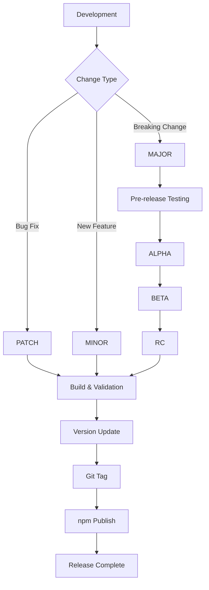

# version# NPM Versioning & Release Strategy

## 1. Overview

This document defines the versioning strategy and release lifecycle for all npm packages used and maintained within the Financial Workflow ecosystem.

All packages must follow **Semantic Versioning (SemVer 2.0.0)** to ensure predictable releases, backward compatibility, and consistent dependency management.

## 2. Semantic Versioning

The standard version format is:

```text
MAJOR.MINOR.PATCH
```

Example:

```text
11.2.5
```

| Component | Description | Purpose |
|---|---|---|
| MAJOR | Breaking Changes | Incompatible API changes |
| MINOR | New Features | Backward-compatible functionality |
| PATCH | Bug Fixes | Backward-compatible bug fixes |

### 2.1. PATCH

Increment PATCH when fixing bugs without changing the public API or breaking existing functionality.

Examples:
- Fixing internal bugs.
- Resolving incorrect calculations.
- Fixing validation issues.
- Improving performance without changing behavior.
- Fixing memory leaks.
- Internal refactoring without public API changes.

Example:

```text
11.2.5 → 11.2.6
```

Command:

```bash
npm version patch

OR

npm version patch --no-git-tag-version
```

### 2.2. MINOR

Increment MINOR when introducing new backward-compatible functionality.

Examples:
- Adding new methods or services.
- Introducing optional configurations.
- Adding new exports.
- Supporting additional features.
- Extending existing functionality without breaking existing consumers.

Example:

```text
11.2.5 → 11.3.0
```

Command:

```bash
npm version minor --no-git-tag-version
npm version minor 
```

### 2.3. MAJOR

Increment MAJOR when introducing breaking changes that require consumers to modify their existing implementation.

Examples:
- Removing existing methods or classes.
- Renaming public APIs.
- Changing method parameters or return types incompatibly.
- Changing required configurations.
- Changing public interfaces or data structures.
- Removing or changing existing exports.
- Introducing incompatible behavior changes.

Example:

```text
11.2.5 → 12.0.0
```

Command:

```bash
npm version major --no-git-tag-version
npm version major
```

## 3. Pre-release Versions

Pre-release versions are used for testing and validating upcoming releases before publishing a stable version.

Format:

```text
MAJOR.MINOR.PATCH-PRERELEASE
```

### 3.1. Release Stages

| Stage | Example | Purpose |
|---|---|---|
| DEV | `12.0.0-dev.1` | Internal development |
| ALPHA | `12.0.0-alpha.1` | Early development testing |
| BETA | `12.0.0-beta.1` | Feature testing |
| RC | `12.0.0-rc.1` | Release Candidate |
| STABLE | `12.0.0` | Production release |

### 3.2. Recommended Release Lifecycle

```text
12.0.0-dev.1
12.0.0-dev.2
12.0.0-alpha.1
12.0.0-alpha.2
12.0.0-beta.1
12.0.0-beta.2
12.0.0-rc.1
12.0.0
```

### 3.3. Commands

```bash
# Development
npm version 12.0.0-dev.1

# Alpha
npm version prerelease --preid=alpha

# Beta
npm version prerelease --preid=beta

# Release Candidate
npm version prerelease --preid=rc

# Stable release
npm version 12.0.0
```

## 4. Version Increment Commands

| Command | Description |
|---|---|
| `npm version patch` | Increment PATCH |
| `npm version minor` | Increment MINOR |
| `npm version major` | Increment MAJOR |
| `npm version prerelease` | Increment pre-release |
| `npm version prepatch` | Increment PATCH and create pre-release |
| `npm version preminor` | Increment MINOR and create pre-release |
| `npm version premajor` | Increment MAJOR and create pre-release |
| `npm version from-git` | Use the version from the latest Git tag |
| `npm version 12.0.0` | Set an explicit version |

## 5. npm Distribution Tags

Distribution tags allow publishing multiple release channels under the same package name.

| Tag | Purpose |
|---|---|
| `latest` | Latest stable release |
| `next` | Upcoming release |
| `dev` | Development release |
| `alpha` | Alpha release |
| `beta` | Beta release |
| `rc` | Release Candidate |

### 5.1. Publishing with Tags

```bash
npm publish --tag dev
npm publish --tag alpha
npm publish --tag beta
npm publish --tag rc
npm publish --tag latest
```

### 5.2. Installing Specific Release Channels

```bash
npm install package-name@latest
npm install package-name@next
npm install package-name@beta
npm install package-name@alpha
npm install package-name@rc
```

### 5.3. Managing Distribution Tags

```bash
# List all distribution tags
npm dist-tag ls package-name

# Add or update a tag
npm dist-tag add package-name@12.0.0-beta.1 beta

# Remove a tag
npm dist-tag rm package-name beta
```

Pre-release versions should not replace the `latest` tag unless explicitly intended.

## 6. Version Selection Guidelines

| Change Type | Version |
|---|---|
| Bug fixes | PATCH |
| Internal refactoring | PATCH |
| Performance improvements | PATCH |
| New methods | MINOR |
| New services | MINOR |
| Optional configurations | MINOR |
| New exports | MINOR |
| Removing public APIs | MAJOR |
| Changing public interfaces | MAJOR |
| Changing required configurations | MAJOR |
| Incompatible type changes | MAJOR |
| Breaking behavior changes | MAJOR |

**Golden Rule:**

If consumers must modify their existing implementation to upgrade to a new release, the change should generally be classified as MAJOR.

## 7. Release Workflow

All packages should follow a consistent release process.



## 8. Publishing Process

### 8.1. Stable Release

```bash
# 1. Verify repository status
git status

# 2. Run validation
npm run lint
npm run typecheck
npm run build

# 3. Increment version
npm version patch

# 4. Preview package contents
npm pack --dry-run

# 5. Publish package
npm publish

# 6. Push commits and tags
git push origin main --follow-tags
```

### 8.2. Beta Release

```bash
# 1. Run build
npm run build

# 2. Create beta version
npm version prerelease --preid=beta

# 3. Preview package
npm pack --dry-run

# 4. Publish beta
npm publish --tag beta

# 5. Push Git tags
git push origin main --follow-tags
```

## 9. Versioning Rules

The following rules must be respected:

1. Published versions cannot be reused.
2. Every public release must have a unique version.
3. MAJOR releases must indicate breaking changes.
4. MINOR releases must maintain backward compatibility.
5. PATCH releases must not introduce breaking changes.
6. Pre-release versions must use appropriate distribution tags.
7. Stable releases should use the `latest` tag.
8. Public APIs must be documented before stable releases.
9. Breaking changes should be documented in the release notes.
10. Version changes must be committed and tagged in Git.

## 10. Recommended Package Versioning Policy

All internal and public npm packages should follow this policy:

| Release Type | Version Format | npm Tag | Environment |
|---|---|---|---|
| Development | `x.y.z-dev.n` | dev | Internal |
| Alpha | `x.y.z-alpha.n` | alpha | Testing |
| Beta | `x.y.z-beta.n` | beta | Pre-production |
| Release Candidate | `x.y.z-rc.n` | rc | Final validation |
| Stable | `x.y.z` | latest | Production |

 