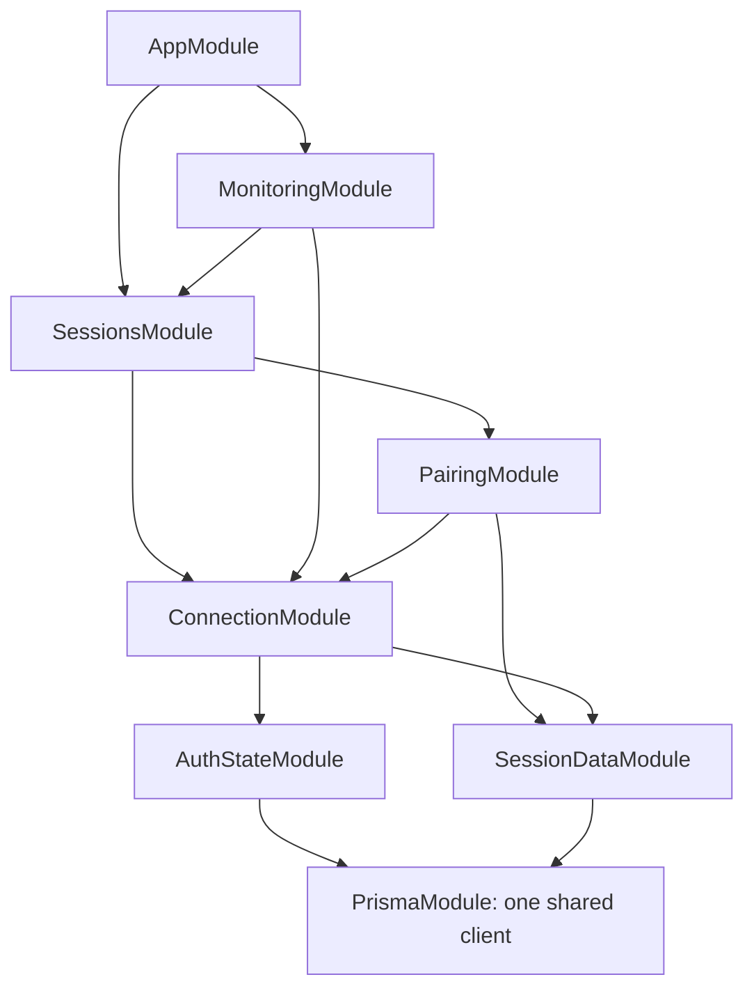

# WhatsApp sessions and connections

The manager runs in one Node.js process and supports up to 50 independent accounts.
Connection lifecycle uses the existing Prisma client and in-process queues.
Message handlers live separately in `src/modules/messages/receive/events`.
The pre-existing Redis module remains available to the application but is not used
by the WhatsApp modules. Do not run two application processes against these sessions.

## Modules and source files



Existing scaffold files under `src/modules/` are implemented in place:

- `auth-state/auth-state/auth-state.service.ts`: MySQL credentials and Signal key
  storage, BufferJSON snapshots, protobuf rehydration, serialized durable writes.
- `connection/providers/session/session-manager.service.ts`: sole runtime/socket
  owner, connection update handling, per-session operation queue, generation
  fencing, cleanup and restoration.
- `connection/socket-factory/socket-factory.service.ts`: stable Ubuntu/Chrome
  browser identity, isolated bounded retry cache, default initial sync preserved.
- `connection/utils/disconnect-classifier.util.ts`: reads
  disconnect errors and classifies installed Baileys disconnect reasons.
- `connection/connection-supervisor/connection-supervisor.service.ts`: capped
  exponential reconnect delays with jitter; counters reset after a stable connection.
- `pairing/pairing/pairing.service.ts`: CODE/QR workflows, phone validation and
  single-flight code requests. QR reads do not restart sockets.
- `sessions/sessions/*`: validated REST controller and application operations.
- `libs/prisma/src/repositories/wa-session/wa-session.repository.ts`: shared
  session metadata/event persistence, exposed to feature modules through
  `sessions/session-data.module.ts` using `WA_SESSION_REPOSITORY`.
- `sessions/admin.guard.ts`: constant-time Bearer key validation and no-store headers.
- `sessions/persistence.filter.ts`: safe HTTP error responses without DB/auth details.
- `monitoring/*`: bounded watchdog checks and aggregated health.

`src/main.ts` installs validation, safe error responses and shutdown hooks.
Prisma disconnect now runs during `onApplicationShutdown`, after socket cleanup
and authentication flushes in `onModuleDestroy`. Existing configuration, Prisma,
Redis and logger tests remain in place. New tests are next to feature services,
and `test/app.e2e-spec.ts` tests the authenticated session API.

New direct dependencies: `@whiskeysockets/baileys` (installed 7.0.0-rc14),
`libphonenumber-js` (international phone validation), and `pino` (Baileys logger
interface). Dependency versions are recorded in package.json and pnpm-lock.yaml.
Baileys internal logs are silenced because they can contain authentication data;
application lifecycle logs include sessionId, generation, event and safe reasons.

## Schema and migration

The actual schema location is `libs/common/src/prisma/schema.prisma`.
`prisma.config.ts` and the Nest library descriptor point to this existing location.

The additive migration `20261104170000_session_lifecycle`:

- Adds `enabled` (default true), preserving manual disconnect across process restarts.
- Adds `pairing_method` (`CODE` / `QR`, default QR).
- Appends `AUTHENTICATING` to the status enum.
- Makes Signal key type/ID comparisons binary so case-distinct keys stay separate.

Subsequent migrations make `phone` required, replace `enabled` with `isEnabled`,
and remove the unused `instance_id` column and its index. The current schema and
generated client must reflect those changes; historical migrations stay intact.

Check migration status and apply pending migrations during deployment:

```bash
pnpm exec prisma migrate status
pnpm run prisma:deploy
pnpm run prisma:generate
```

Do this before starting the new code: the new fields must exist in MySQL.
Take normal database backups before deployment. There are no automatic migrations
at application startup. The development start scripts regenerate the client;
restart the watcher after changing the schema or applying migrations so it cannot
keep querying a removed column from an older generated client.

## Configuration

All settings are validated through the existing config module and exposed through
`IAppConfig.whatsapp` / `IWhatsAppConfig`. Local `.env` contains a generated admin
key; it is not printed in logs or documentation. Set your own production secret.

| Variable | Default | Meaning |
| --- | --- | --- |
| `WA_ADMIN_API_KEY` | Required, at least 32 characters | Bearer administration/pairing key |
| `WA_MAX_SESSIONS` | `50` | Process account limit, maximum 50 |
| `WA_STARTUP_CONCURRENCY` | `2` | Initial connection attempts in flight, maximum 5 |
| `WA_STARTUP_STAGGER_MS` | `500` | Delay between restoration attempts |
| `WA_WATCHDOG_INTERVAL_MS` | `30000` | Monitoring interval |
| `WA_CONNECTION_STUCK_MS` | `120000` | Connecting/authenticating state timeout |
| `WA_STABLE_CONNECTION_MS` | `60000` | Connected duration before retry counter reset |
| `WA_PAIRING_TTL_MS` | `60000` | QR rotation and application expiry, maximum 60000 |
| `WA_PAIRING_CODE_TTL_MS` | `180000` | Application code validity window, maximum 180000 |
| `WA_PAIRING_RATE_LIMIT_MS` | `30000` | Minimum gap between new code requests |

Existing `MYSQL_*`, app port/prefix and existing Redis configuration still apply.
The current local prefix is `api`, so examples use `/api/sessions`.
With `API_PREFIX=` the routes are `/sessions` and `/health` instead.

Expose this API through HTTPS. Limit access to trusted administrators; pairing
codes and raw QR strings are login secrets. Protect database backups/access too:
auth rows contain long-lived private keys. Encryption at rest is an infrastructure
responsibility in this implementation. API keys are shared administration keys,
not per-user identities or tenant authorization.

## Testing with Swagger

Start the application with `pnpm start:dev`, then open
[Swagger UI](http://localhost:3000/docs). OpenAPI JSON is at `/docs-json`.
These documentation paths do not change with `API_PREFIX`; API paths inside the
spec do. With the current `.env`, requests target `/api/sessions` and `/api/health`.
If `APP_PORT` changes, use that port for the documentation URL too.

1. Click **Authorize**, paste only the value of `WA_ADMIN_API_KEY` from local
   `.env`, click **Authorize**, then **Close**. Do not include `Bearer` in the
   value: Swagger adds it. The key is not saved across page reloads.
2. Execute **GET /api/health** using **Try it out → Execute**. Expect 200 and
   aggregate counts. A 401 means the key is missing/wrong or authorization must
   be repeated after reloading the page.
3. Execute **POST /api/sessions**. Select the `code` example and replace its phone
   with your own valid international number. Reusing a phone replaces its current session. The 201
   response includes `id`; copy it for subsequent path parameters.
4. Execute **POST /api/sessions/{id}/pairing-code** with that ID and body `{}`.
   It may wait for socket readiness. Enter the returned code in WhatsApp's
   linked-device phone-number linking flow. Do not treat AWAITING_PAIRING as
   success and do not share the code or its response.
5. Execute **GET /api/sessions/{id}** until `runtime.connected` is true.
   A brief AUTHENTICATING/RECONNECTING transition after pairing is expected.
6. Test **disconnect**: authentication remains, `isEnabled` becomes false and no
   automatic reconnection occurs. Then test **reconnect**: the same persisted
   credentials should reconnect without another pairing step. Check status again.
7. Stop the process with Ctrl+C and restart it with the same database. Enabled
   paired sessions should restore; manually disabled sessions stay disconnected.
   Check `runtime.connected` rather than relying on the stored CONNECTED status.

For QR pairing, create a separate session using the `qr` example and provide its
phone number, which is required for both QR and CODE. Read
**GET /api/sessions/{id}/qr** until `qr` is non-null. Swagger shows a raw string,
not a scannable image. Render that value locally in a trusted QR-capable UI, scan
it from the phone's linked-device flow and poll status. Do not send the login QR
to third-party conversion sites. Read again on refresh/expiry; the QR endpoint
never restarts the socket. To explicitly renew expired pairing, use
**POST /api/sessions/{id}/qr** with `{}`.

Troubleshooting while using **Execute**:

- **400**: inspect `message` for invalid fields/phone or an incompatible request.
- **401**: repeat Authorize with the actual configured administration key.
- **404**: replace the example ID with the ID returned when creating your session.
- **409**: active-session capacity, already authenticated session, incompatible operation
  or session limit. Reuse the existing session and choose reconnect when paired.
- **429**: wait for the configured pairing rate-limit window before another new code.
- **503**: inspect safe lifecycle logs and verify database/WhatsApp connectivity.
- **qr: null**: the socket is not ready, CODE is selected, pairing expired, or the
  account is already authenticated. Check the method/status and retry the read.

`logout` intentionally unlinks a connected device and invalidates local auth;
`DELETE` soft-deletes the session by setting `isEnabled=false` and stopping its
socket. Metadata and authentication remain available for explicit reconnect.

Swagger configuration follows the [NestJS OpenAPI setup](https://docs.nestjs.com/openapi/introduction).

## API

Every endpoint below requires `Authorization: Bearer <WA_ADMIN_API_KEY>`.
Responses have `Cache-Control: no-store`. DTOs reject unknown body properties.
Phone input must be a valid international number, with or without `+`; storage
and Baileys calls use E.164 digits without `+`.

| Method | Route (before global prefix) | Behavior |
| --- | --- | --- |
| POST | `/sessions` | Create metadata and initiate connection; does not wait for pairing |
| GET | `/sessions` | List safe metadata and current runtime snapshots |
| GET | `/sessions/:id` | Persisted metadata plus current runtime status |
| POST | `/sessions/:id/pairing-code` | Generate/reuse code; optional `{ "phone": "..." }` |
| GET | `/sessions/:id/qr` | Current raw QR and application expiry, or null |
| POST | `/sessions/:id/qr` | Select QR and start or renew pairing on an unregistered session |
| POST | `/sessions/:id/reconnect` | Manual restart/reset retry count using persisted auth |
| POST | `/sessions/:id/disconnect` | Disable automatic restore/retry, close without logout |
| POST | `/sessions/:id/logout` | Confirm remote logout, then invalidate local auth |
| DELETE | `/sessions/:id` | Soft-delete with `isEnabled=false`, cancel retries and stop/drain the socket; retain metadata/auth/events |
| GET | `/health` | Process uptime and aggregate session connection counts |

Creation returns HTTP 201 with session ID, metadata and runtime. Pairing code
requests wait up to 60 seconds for socket readiness and can return 503 if not ready.
Malformed bodies return 400, missing/invalid token 401, missing sessions 404,
phone/operation conflicts 409, code rate limits 429, persistence failures 503, and unexpected internal failures 500.
The requested phone is checked against the actual linked WhatsApp identity before
CONNECTED is persisted. New sessions require a phone for both QR and CODE;
legacy QR sessions without a phone record the linked phone.

### Pairing Code example

Set `WA_ADMIN_API_KEY` in your shell to the value configured in `.env`. Do not
paste it into logs, source code or shared screenshots.

```bash
export BASE_URL=http://localhost:3000/api

curl -X POST "$BASE_URL/sessions" \
  -H "Authorization: Bearer $WA_ADMIN_API_KEY" \
  -H 'Content-Type: application/json' \
  -d '{"name":"WhatsApp 01","phone":"989121234567","pairingMethod":"CODE"}'
```

Use the returned ID below:

```bash
curl -X POST "$BASE_URL/sessions/SESSION_ID/pairing-code" \
  -H "Authorization: Bearer $WA_ADMIN_API_KEY" \
  -H 'Content-Type: application/json' -d '{}'
```

Enter the returned code in the phone's linked-device workflow. Returning a code
means AWAITING_PAIRING, **not** CONNECTED. Poll the status endpoint for the current
runtime state. Repeated requests return the same unexpired code; parallel requests
share one operation. Failed new requests are rate limited too.

### QR Code example

```bash
curl -X POST "$BASE_URL/sessions" \
  -H "Authorization: Bearer $WA_ADMIN_API_KEY" \
  -H 'Content-Type: application/json' \
  -d '{"name":"WhatsApp 02","pairingMethod":"QR"}'

curl "$BASE_URL/sessions/SESSION_ID/qr" \
  -H "Authorization: Bearer $WA_ADMIN_API_KEY"
```

The raw QR may initially be null while connecting. Poll again; reads do not create
or restart sockets. Render the returned string with a QR renderer in your trusted
UI, and refresh when the value changes. Only the current session's QR is returned.
QR rotation uses Baileys `qrTimeout`; expiresAt is the application validity bound.
Pairing code expiresAt is also an application bound, not a guarantee that WhatsApp
will accept the code until that exact instant. Codes/QRs are cleared on expiry,
authentication and socket replacement; pairing material is never written to events.

Select or renew QR pairing for an unregistered session; use `/pairing-code` to select CODE and receive its code:

```bash
curl -X POST "$BASE_URL/sessions/SESSION_ID/qr" \
  -H "Authorization: Bearer $WA_ADMIN_API_KEY" \
  -H 'Content-Type: application/json' -d '{}'
```

Normal reconnections restore persisted credentials. `restartRequired` after
pairing is a controlled, generation-fenced restart. An existing paired session
must use `/reconnect`, rather than the pairing endpoints.

## Reconnection, restart and deletion

Network failures retry independently per session with one timer, exponential
backoff capped at 60 seconds and jitter in the upper half of the window. There
is no retry-attempt limit for temporary failures. Retry counters reset after a
stable connection, not immediately on every open event. Only the first
`restartRequired` is fast (250 ms); repeated protocol restarts use normal backoff.
Logged-out, replaced, invalid-auth and expired-pairing sessions do not auto-retry. A known Baileys QR-exhaustion
error is distinguished from a transient timeout; transient failures during initial
pairing can reconnect too.

After SIGINT/SIGTERM, restart with the same MySQL database and admin config. The
manager restores enabled eligible sessions in background with bounded concurrent
initial handshakes and staggering. A previous database CONNECTED value does not
prove the new process is connected: inspect `runtime.connected`.

Enabled sessions marked FAILED solely by the old `Reconnect threshold reached`
limit are eligible for restoration too. Other FAILED, LOGGED_OUT and EXPIRED
sessions remain excluded.

Shutdown stops new work, cancels timers, ends sockets **without logout**, and
awaits queued authentication writes before Prisma disconnects. Watchdog checks use
WebSocket readiness and Baileys keepalive, not the presence of incoming messages.
An idle account is healthy. A failed auth write closes the session and reports a
failure instead of continuing with potentially lost state.

`/disconnect` persists `isEnabled=false`; it remains disconnected after restart.
`/reconnect` enables it again. `/logout` requires a currently connected session;
if remote logout cannot be confirmed, local credentials are retained and automatic
reconnect is stopped. If WhatsApp already logged the account out, explicitly
selecting pairing again clears invalid credentials and starts fresh authentication.
For badSession/forbidden/multideviceMismatch, only an explicit pairing action resets
the known-invalid stored auth. Other errors never silently erase credentials.

**Deletion policy:** DELETE returns HTTP 204 after persisting `isEnabled=false`,
cancelling retries and stopping/draining the socket without remote logout. The
session, credentials, keys and events remain stored. Disabled sessions stay visible
in list/details and the test panel, and are not restored after process restart.
Repeated DELETE requests are safe; an unknown session returns 404. Use the panel's
reconnect action or `/reconnect` to resume with stored credentials. A logged-out
session still requires explicit pairing. Socket/authentication cleanup failures
return 503 while the session remains disabled.

## Validation and operations

```bash
pnpm test
pnpm run test:e2e
pnpm run lint
pnpm run typecheck
pnpm exec prisma validate
pnpm run build
```

Unit tests mock sockets and database calls; API tests mock external services.
They require no real WhatsApp account and never migrate/reset the database.
Tests cover session creation/limits, restoration, QR refresh and expiry, pairing
code single-flight/readiness, successful pairing and restartRequired, network
retries, terminal disconnects, stable reset, stale generations, auth serialization,
key deletion, write failures, staggered bounded startup, watchdog/manual stops,
explicit logout and graceful shutdown.

To exercise live reconnection in a staging environment, pair an account, verify
`runtime.connected`, briefly interrupt that process's WhatsApp network access,
restore it, and observe RECONNECTING -> CONNECTING -> CONNECTED plus retry logs.
Do not interrupt MySQL for this test: auth persistence loss intentionally fails
closed. Check that `/disconnect` prevents retries and process-restart restoration,
then use `/reconnect` to resume. Test QR/CODE on separate staging accounts first.

No live account pairing or real-device recovery is asserted by the automated
checks. Baileys is an unofficial WhatsApp client and the installed version is a
release candidate; protocol changes, device limits and server rejection require
staging verification. QR image generation, message processing, outbound queues,
distributed deployment, role-based access and an event-retention job are outside
this phase. Lifecycle events accumulate in MySQL; plan retention/backups for your
operational environment. Authentication write queues deliberately fail closed;
recovery from a DB/auth write error requires investigation and an explicit restart.
